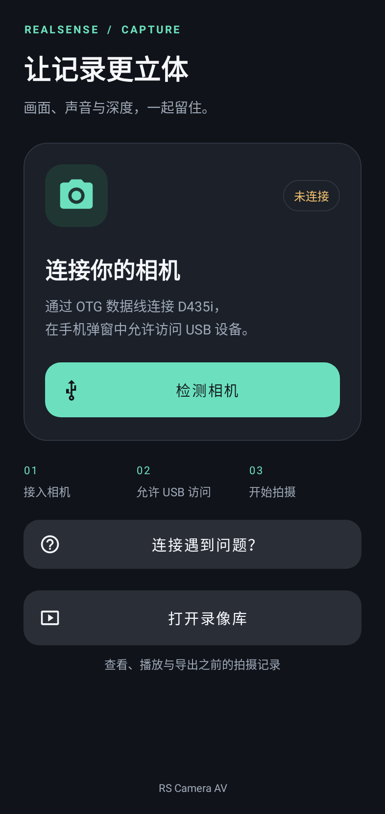
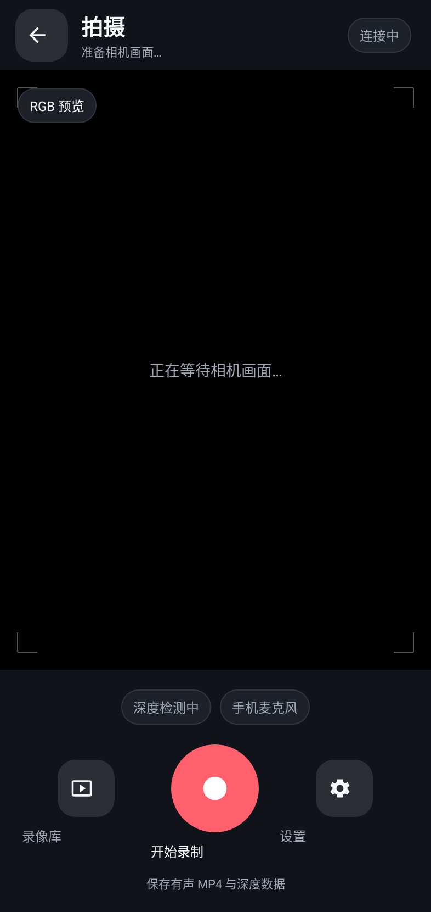
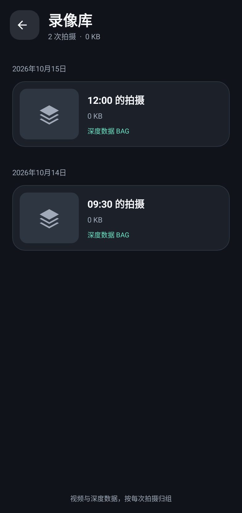

# RS Camera AV

用 Android 手机控制 Intel RealSense D435i，同时录制彩色视频、手机麦克风声音和 RealSense 原始深度数据。

**当前版本：0.0.9 · Android ARM64**

## 下载与安装

从 [Releases 最新版本](https://github.com/123qwe140/realsense-android-camera-av/releases/latest) 下载 `RS-Camera-0.0.9-capture-arm64.apk`，将 APK 复制到手机的“下载”目录后点击安装。已有同包名的 0.0.8 开发版可以直接更新；安装包由本项目开发环境签名。

安装后，用支持数据传输的 USB-C OTG 线连接 D435i，按提示允许 USB 访问。进入拍摄页后首次录音会请求麦克风权限。建议先录制一段短视频，确认声音、视频和深度文件都能正常保存。

## 录制内容

- 手机屏幕显示 RGB 实时预览，可控制开始、停止和查看录像。
- 每次录制保存有声 MP4、包含原始相机流的 BAG，以及时间戳同步信息。
- 手机麦克风声音保存在 MP4；BAG 保留 RealSense 相机数据，不包含手机音轨。
- 录像库支持视频回放、查看 BAG 深度数据和导出单个文件或 ZIP。

## 设备与限制

- 开发目标：RealSense D435i、iQOO Z7x、Android 13、ARM64。
- 最低 Android 版本：Android 7.0（API 24），并需要 USB Host / OTG。
- 页面和本地文件管理已在 Android 测试环境验证；D435i 与 iQOO Z7x 的 USB、长时间录制、音画同步尚未完成真机验证。
- 音频和相机帧使用软件时间戳同步；没有宣称硬件同步或长期漂移精度。
- 应用在录制期间需要保持前台运行；切到后台或锁屏会结束录制并尝试保存。

## 界面预览

| 首页 | 拍摄 | 录像库 |
|---|---|---|
|  |  |  |

预览图由 Android UI 测试环境渲染；其中摄像头画面和录像库文件为占位示例。

## 从源码构建

完整 Android 工程位于 `source/librealsense-2.58.1/wrappers/android`。使用 Android Studio 打开该目录，安装 Android SDK 35、Build Tools 35、JDK 17、NDK 28.0.13004108 和 CMake 3.22.1，然后构建 `tools:camera` 模块。

Windows 可使用项目脚本。完整原生构建对 Windows 路径长度敏感，请把仓库克隆到较短路径（例如 `C:\rs-rgb`）：

```powershell
.\scripts\build.ps1 -SdkPath "C:\Android\Sdk" -JavaHome "C:\Java\jdk-17"
```

只改 Java 或界面时可用 `scripts/build-java.ps1`；该方式会复用 APK 中的 RealSense 原生库，不会重新编译 C++。从 GitHub 克隆源码后，请先从 Releases 下载当前 APK，并放入 `outputs` 文件夹，再运行 Java/UI 构建脚本。完整依赖和详细步骤见 [开发交接文档](docs/开发交接.txt)、[音视频说明](docs/音视频开发说明.md) 和 [界面改版说明](docs/界面改版说明.md)。

## 许可与来源

本项目基于 [Intel RealSense librealsense 2.58.1](https://github.com/realsenseai/librealsense/tree/v2.58.1)，并包含为 Android 相机应用编写的修改。项目采用 Apache-2.0 许可；第三方组件各自的版权和许可文件保留在源码中。随附的 nlohmann/json 3.12.0 使用 MIT 许可。

APK 是调试签名构建，未提供签名私钥。源码编译出的调试 APK 使用本机密钥签名，无法作为同签名更新覆盖 Release 中的 APK；请先从源码安装自己的构建版本，再继续使用同一台电脑更新。
